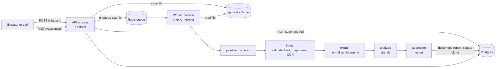

# Architecture

## The shape: a modular monolith with a separate worker

One codebase, one image, two processes (API and worker), plus Postgres and Redis. See
[ADR-002](decisions/ADR-002-modular-monolith.md) for why.

The package folders mirror the stages, so when one stage needs to become its own service later the
seam already exists. Until there is a real reason (independent scaling, different language, a team
boundary) it stays one codebase.

## Request flow

1. `POST /v1/scans` checks size early (from `Content-Length`), reads the upload, **sniffs the real file
   type from the bytes**, validates pixels and page count, stores it under a random key, inserts a
   `Scan(status=queued)`, **commits**, then enqueues the scan id. Commit comes before enqueue so the
   worker never looks for a row that is not there. If the broker is down the scan is marked `failed` and
   the client gets `503`.
2. The worker marks the scan `processing` and runs the stages, each timed and logged with the `scan_id`.
3. On success it writes a `Document` and a `Report` and marks the scan `done`. On any failure it rolls
   back and marks the scan `failed` with a user-safe message (never an internal error string).
4. The client polls `GET /v1/scans/{id}`. State lives in the database, so Celery has no result backend.

**Delivery guarantees.** The worker uses `acks_late` and `reject_on_worker_lost`, so a job is redelivered if
a worker dies mid-scan. That makes the pipeline **at-least-once**, so it is idempotent: a scan that is already
`done` or `failed` is skipped, and one stuck in `processing` is simply run again.

## Data model

- `scans`: id (uuid), status (`queued`, `processing`, `done`, `failed`), input kind, declared content type
  (untrusted), size, storage key, error, timestamps.
- `documents`: one per scan. Page count, normalised text, char count, `text_sha256` (indexed, for spotting the
  same text uploaded again later), OCR engine, mean confidence.
- `reports`: one per scan. Band, summary, signals (JSON), limitations (JSON), pipeline version.

Schema changes go through Alembic only. The tests use `create_all` for speed, and `alembic check` is the guard
against the models and migrations drifting apart.

## The report is deliberately modest

Signals have a **kind**: `quality` (how good was the input), `heuristic` (writing-style cues, weak on their own),
`evidence` (checked against something outside the text). Only evidence can move the band away from
`insufficient_evidence`. Details are in the README.

## Security notes (what is done, what is not)

Done: upload type by magic bytes; size, pixel and page limits; random storage keys validated on every use;
no path from user input to the filesystem; CSP, `nosniff` and `Referrer-Policy` on the HTML pages; the UI renders
OCR text only with `textContent` (it is untrusted input); `Cache-Control: no-store` on scan responses; generic error
messages; non-root container with all capabilities dropped; only localhost ports published.

Not done yet: authentication, rate limits and quotas, SSRF protection (needed when URL input arrives),
prompt-injection handling (needed if an LLM ever reads the text), virus scanning, retention and deletion of uploads.

## Observability contract (what Project 1 will scrape)

Metrics (Prometheus format, API on `:8000/metrics`, worker on `:9101/metrics`):

| Metric | Type | Labels |
|---|---|---|
| `newsscan_http_requests_total` | counter | method, route (template), status |
| `newsscan_http_request_duration_seconds` | histogram | method, route |
| `newsscan_scans_submitted_total` | counter | |
| `newsscan_scans_finished_total` | counter | outcome (`done`, `failed`) |
| `newsscan_stage_duration_seconds` | histogram | stage |
| `newsscan_queue_depth` | gauge | (NaN if Redis is unreachable) |

Route labels use the route **template** (`/v1/scans/{scan_id}`), never the raw path, so cardinality stays bounded.
Logs are JSON, one object per line, with `scan_id` and `stage` where relevant. Traces are not implemented; they are
the third stage of Project 1 (ADR-001).

## Milestones

| | Milestone | State |
|---|---|---|
| M1 | Walking skeleton: scan, OCR, register, signals, report, metrics, JSON logs, Compose | done |
| M2 | OCR evaluation harness on your own real scans; decide ADR-003 with numbers | next |
| M3 | More inputs (pasted text, URL with SSRF protection); source signals | |
| M4 | Claim extraction (Groq LLM) and Google Fact Check lookup, ADR-005 | built; tested with fakes and a few live samples, not measured on real scans |
| M5 | Hardening: auth, rate limits, quotas, retention | |
| M6 | OpenTelemetry tracing (when Project 1 reaches the tracing stage) | |
| M7 | React frontend (optional; the static page is enough until then) | |
