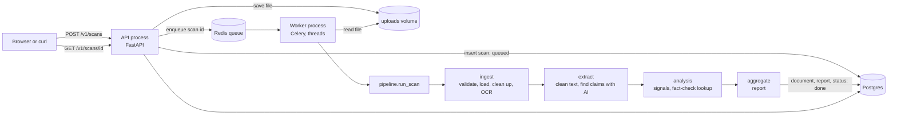

# Architecture

## The shape: one codebase, with a separate worker

One codebase, one image, two processes (the API and the worker), plus Postgres and Redis. See
[ADR-002](decisions/ADR-002-modular-monolith.md) for why.

The folders match the stages. If one stage ever needs to become its own service, the split is already there. Until
there is a real reason (scaling on its own, another language, a separate team) it stays one codebase.

## What happens to a request

1. `POST /v1/scans` checks the size early, reads the upload, **works out the real file type from the bytes**,
   checks pixels and page count, saves the file under a random name, adds a `Scan` row with status `queued`,
   **commits**, and only then puts the scan id on the queue. Committing first means the worker never looks for a row
   that isn't there. If the queue is down, the scan is marked `failed` and the client gets a `503`.
2. The worker marks the scan `processing` and runs the stages. Each stage is timed and logged with the `scan_id`.
3. On success it saves a `Document` and a `Report` and marks the scan `done`. On any failure it undoes its changes
   and marks the scan `failed` with a safe message (never an internal error).
4. The client asks `GET /v1/scans/{id}` until it's done. The state lives in the database, so Celery needs no result store.

**If a worker dies.** The worker only confirms a job after it finishes (`acks_late`), so a job is handed out again if a
worker dies halfway. That means a job can run twice, so it is safe to repeat: a scan already `done` or `failed` is
skipped, and one stuck in `processing` is simply run again.

## Data

- `scans`: id (uuid), status (`queued`, `processing`, `done`, `failed`), input kind, declared content type (not
  trusted), size, storage key, error, times.
- `documents`: one per scan. Page count, cleaned text, character count, `text_sha256` (indexed, to spot the same text
  uploaded again), OCR engine, mean confidence.
- `reports`: one per scan. Band, summary, signals (JSON), limits (JSON), pipeline version.

Schema changes go through Alembic only. Tests use `create_all` because it's faster, and `alembic check` catches the
models and migrations drifting apart.

## The report is modest on purpose

Each signal has a **kind**: `quality` (how good was the input), `heuristic` (a weak writing-style hint), or
`evidence` (checked against something outside the text). Only evidence can move the band away from
`insufficient_evidence`. The README has the details.

## Security: what is done and what isn't

Done: upload type found from the file's bytes; limits on size, pixels and pages; random storage names, checked every
time; no way for user input to reach file paths; CSP, `nosniff` and `Referrer-Policy` on the HTML pages; the page
shows OCR text only with `textContent`, because it's untrusted; `Cache-Control: no-store` on scan answers; generic
error messages; a non-root container with all capabilities dropped; only localhost ports published.

Partly done: **prompt injection.** The AI calls (ADR-005, ADR-006) get the page text as quoted data with an
instruction to ignore commands inside it, and their replies are checked before use. That makes it harder, but it
isn't proven. There is no attack testing yet.

Done: an upload rate limit (ADR-013).

Not done yet: login, protection against requests to internal addresses (needed when URL input
arrives), virus scanning, and deleting old uploads.

## What the monitoring watches

Metrics (Prometheus format). The API is on `:8000/metrics` and the worker on `:9101/metrics`. The worker also
answers `:9101/healthz` (alive); any other path there is a 404.

| Metric | Type | Labels |
|---|---|---|
| `newsscan_http_requests_total` | counter | method, route (template), status |
| `newsscan_http_request_duration_seconds` | histogram | method, route |
| `newsscan_scans_submitted_total` | counter | |
| `newsscan_scans_finished_total` | counter | outcome (`done`, `failed`) |
| `newsscan_stage_duration_seconds` | histogram | stage |
| `newsscan_queue_depth` | gauge | (NaN if Redis can't be reached) |
| `newsscan_external_calls_total` | counter | service (`groq`, `factcheck`), outcome (`ok`, `error`) |
| `newsscan_rate_limited_total` | counter | window (`minute`, `day`) |

Route labels use the route **template** (`/v1/scans/{scan_id}`), never the real path, so the number of label values
stays small. Logs are JSON, one object per line, with `scan_id` and `stage` where they apply. There is no tracing, by
choice (ADR-011).

## Milestones

| | Milestone | State |
|---|---|---|
| M1 | Basic working version: scan, OCR, save, signals, report, metrics, JSON logs, Compose | done |
| M2 | OCR evaluation on your own real scans; settle ADR-003 with numbers | next |
| M3 | More inputs (pasted text, URL with protection against internal addresses); source signals | |
| M4 | AI finds claims (Groq), Google Fact Check lookup, satire hint (ADR-005, ADR-006) | built; tested with fakes and a few live samples, not measured on real scans |
| M5 | Hardening: login, rate limits, quotas, deleting old uploads | |
| M6 | OpenTelemetry tracing | dropped (ADR-011) |
| M7 | React frontend (optional) | |
